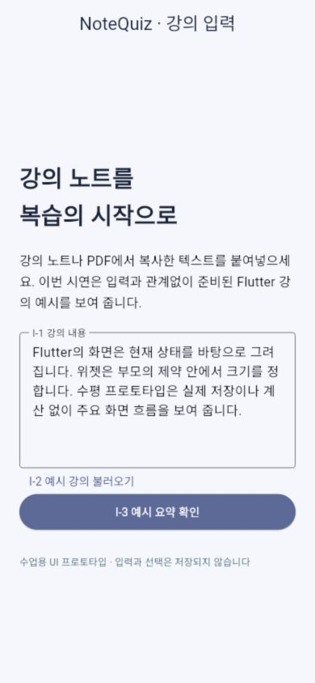
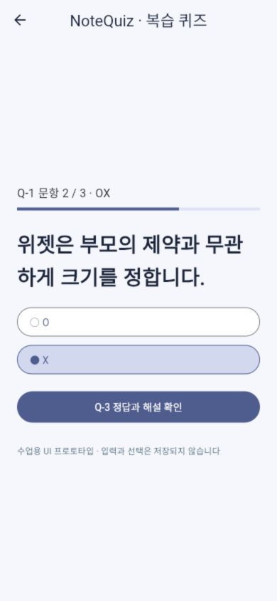
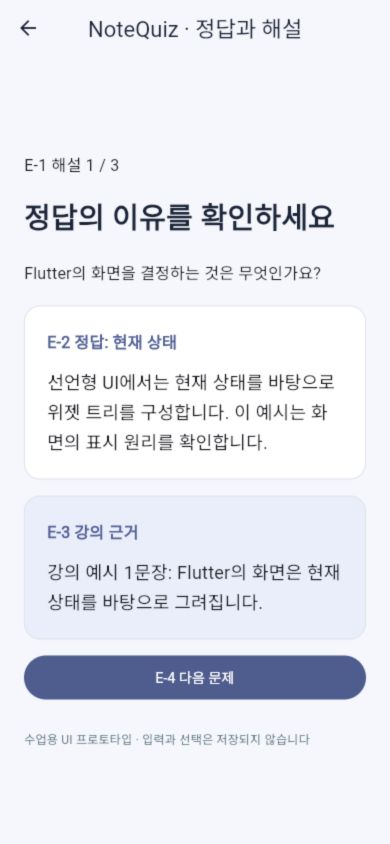
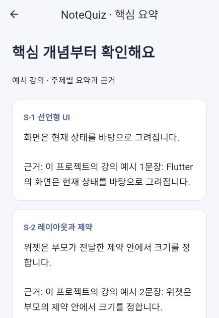

# NoteQuiz v2 — GAI3008 중간프로젝트

## 앱 소개
### 앱 이름
NoteQuiz
### 부제
강의 노트를 핵심 요약과 복습 퀴즈로
### 카테고리
교육
### 대상 사용자 / 사용 상황
긴 강의 자료 정리에 시간이 많이 들고 시험 전에 핵심을 빠르게 복습하려는 대학생. 이동 중 폰, 집에서는 넓은 화면을 사용한다(가상 페르소나).
### 스크린샷
| 강의 입력 | 퀴즈 | 해설 | 넓은 화면 |
|---|---|---|---|
|  |  |  |  |
실제 브라우저 실행 캡처. 비교 대상은 [Knowt 상품 페이지](https://apps.apple.com/us/app/knowt-ai-flashcards-notes/id6463744184). `before-original.png`는 제공된 자료의 초기 설계 비교안이며 Knowt 화면이 아니다.
### 설명
강의 노트나 PDF에서 복사한 텍스트를 붙여넣고, 주제별 핵심 요약과 객관식·OX 문제, 정답·해설·강의 근거를 순서대로 확인하는 UI 프로토타입이다.
Knowt의 복습 정보 불일치 경험 R06에서 문제를 도출했다. NoteQuiz는 공식 Knowt 업데이트가 아닌 개인 개선안이다.
AI 기능 기획: 핵심 개념·용어 추출, 주제 요약, 문제·선택지·정답·해설 구조화. **현재 앱은 실제 AI를 호출하지 않고 입력과 관계없이 고정 예시를 GET으로 표시한다.**
### 새로운 기능
| 원칙 | 변경 | 근거 |
|---|---|---|
| P01 | Q-1 진행 위치, 공통 3상태 | 현재 상태 인지 |
| P04 | Q-2/E-2 동일 문항 객체 | R06 |
| P06 | E-3 원문 항상 표시 | 학생의 실제 선택과 비교 필요 |
| P09 | C-2 지속 안내와 재시도 | R23 간접 근거, 연결 실패 테스트 |
### 평가 및 리뷰
Knowt 미국 App Store: 4.7, 11,175개 평가(2026-10-29 확인). 최근 30개 리뷰 표본과 전체 평가는 구분한다.
R06: “repeating the same four choices” — ★4, 2026-10-12. 작성자명 삭제. [분포와 분류](docs/리뷰근거.md)

## 작성자 · 제출 정보
| 칸 | 내용 |
|---|---|
| 현행 앱 | Knowt: AI Flashcards & Notes |
| v2 한 문장 | 문항과 정답·해설·근거를 같은 흐름에서 비교한다 |
| 작성자 | zhaoboda · 2025106293 · 1인 1팀 |
| 데모 | [1분 편집 시연](docs/영상/demo_1min.mp4) — 실제 브라우저 캡처와 명시한 위젯 상태 캡처를 편집한 영상, 연속 화면 녹화 아님 |
| AI 사용 | [prompt-log](docs/prompt-log.md), [셀프 논증](docs/셀프논증.md), AGENTS.md |
| 제출 상태 | 로컬 완성본. 개인 GitHub 원격과 LMS 제출 미완료 |

## 실행 방법
준비: Flutter stable(Dart 3.13 검증), Node.js 18 이상. 이 폴더를 압축 해제한다.

터미널 1:
```sh
cd mock_server
npm ci
npm start
```
터미널 2(프로젝트 루트):
```sh
flutter pub get
flutter run -d chrome
```
Web 배포 파일을 로컬에서 실행하려면:
```sh
flutter build web --release
```
그 뒤 서버가 실행 중인 `http://localhost:3000`을 브라우저에서 연다. `build/web`를 json-server가 함께 제공한다. 다른 컴퓨터에 공개하는 서비스는 아니다.

Mac에서는 `启动NoteQuiz.command`, Windows에서는 `启动NoteQuiz.cmd`를 실행할 수도 있다. Node/Flutter가 PATH에 있어야 한다. 앱을 닫을 때 서버 터미널에서 Ctrl+C.

### 환경과 상태 시연
- 웹 기본 API: http://localhost:3000. Android 에뮬레이터: http://10.0.2.2:3000 (기본 서버는 루프백 바인딩이므로 네이티브 접근은 별도 확인 필요).
- 다른 주소: `flutter run -d chrome --dart-define=API_BASE=http://localhost:3000`
- `flutter run -d chrome --dart-define=DEMO_STATE=loading` : 3초 뒤 실제 GET
- `flutter run -d chrome --dart-define=DEMO_STATE=error` : 의도적 오류(이 모드에서 재시도해도 계속 오류)
- `flutter run -d chrome --dart-define=DEMO_STATE=empty` : 빈 목록
- 실제 복구 검증: 일반 모드에서 서버를 끄고 요약을 열어 오류를 확인, 서버를 다시 켠 뒤 ‘다시 시도’.
- GET /topics, /questions, /results. 클라이언트에서 쓰기 요청 없음. 서버도 GET/HEAD/OPTIONS 외 거부.

## 구조와 범위
`lib/api.dart`: GET / `lib/widgets.dart`: 3상태·반응형 공통 / `lib/screens/`: input, summary, quiz, explanation, result.
`mock_server/db.json`: 고정 데이터 / `docs/`: 기획·가이드·원칙·논증·리뷰·검증 / `presentation/`: 발표자료.
UI 점수 표시는 상수 예시다. 로그인·가입·결제·채점·영구 저장·추천·상태관리 패키지 없음. 로컬 선택만 setState.

## 검증
```sh
flutter analyze
flutter test
flutter build web --release
```
[검증 기록](docs/verification.md). 제공 플랫폼 중 Web만 검증. 최초 빌드는 SDK/패키지 및 Web 렌더러 다운로드에 인터넷이 필요할 수 있다.

## 템플릿 출처와 제출
기반: https://github.com/xide-projext/mid-project-template / 커밋 3a2d643ed1ff23d378995e5902d42f9edec74fe1.
[변경 기록](docs/출처와변경.md). 제출자는 개인 GitHub 저장소를 만들고 이 폴더를 업로드한 뒤 새 경로에서 clone 테스트를 해야 한다. `node_modules`, `.dart_tool`, `build`는 Git에서 제외한다.
LMS에는 **개인 GitHub URL과 발표 PPTX 또는 PDF**를 제출한다. 이 README의 상대 영상 링크는 영상까지 GitHub에 올려야 온라인에서 접근할 수 있다.
