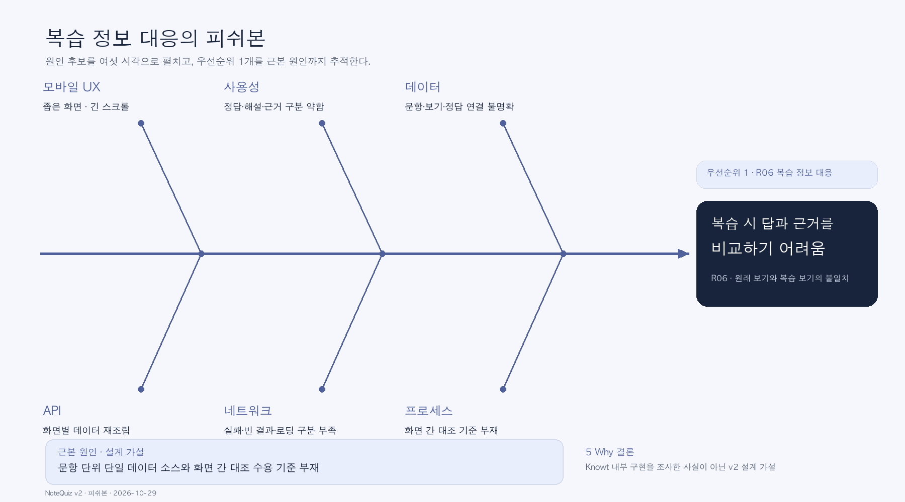

# NoteQuiz v2 기획 상세

## 사업 요약 1쪽

목표: 대학생이 강의 텍스트의 핵심을 읽고, 문항·원래 보기·정답·해설·근거를 같은 흐름에서 검토한다.

대상: 긴 강의 자료 정리에 시간이 들고 시험 전 핵심을 빠르게 복습하려는 대학생.

가상 페르소나: 21세 대학생. 이동 중 폰으로 복습하고 집에서는 노트북으로 자료를 정리한다. 관찰 사실이 아닌 설계 가정이다.

문제: R06의 오답 복습 정보 대응 혼란, R12·R23의 입력·읽기 실패.

핵심 가치: 정답의 이유와 강의 근거를 숨기지 않고, 원래 보기와 내 선택까지 같은 화면에서 비교한다.

범위: 교육 앱. AI 기능은 향후 계획이며 현재는 고정 예시 GET만 구현한다.

성공 조건: 입력-요약-퀴즈-해설-결과 이동, 같은 문항의 원래 보기·정답·근거 일치, 실패 후 재시도, 폰과 넓은 화면 읽기. 학습 효과 향상은 검증하지 않았다.

## 사용자 저니

목표: 시험 전 핵심 개념을 이해하고 틀린 개념을 근거와 함께 다시 확인한다.

| 항목 | 입력 | 핵심 복습 | 문제 풀이 | 해설 검토 |
|---|---|---|---|---|
| 행동 | 강의 텍스트 붙여넣기 | 주제·용어 읽기 | 객관식·OX 선택 | 원래 보기·내 선택·정답·이유·원문 비교 |
| 리뷰 | R12·R23 | R02·R25 | R06 | R06 |
| 연결의 한계 | 사진 입력 실패를 텍스트 입력 안내에 간접 적용 | 회상·시험 준비 호평, 요약 UI 직접 평가 아님 | 퀴즈 선택지 보고 | 오답 복습 정보 불일치 직접 보고 |
| 감정 가설 | -1 | +1 | 0 | -2 최저점 |
| 사용 기기 | 폰·노트북 | 폰·노트북 | 폰 | 폰·넓은 화면 |
| AI 활용 기회 | 텍스트 구조화 | 주제·용어 추출 | 문제 구조화 | 원문 근거 연결 |
| 원칙 위험 | P05·P09 | P08·P06 | P01·P04 | P04·P06 |
| 필요한 데이터 | 예시 강의 텍스트 | GET /topics | GET /questions | 같은 question + selected |

감정은 관찰·설문값이 아니다. 직접 근거가 없는 요약 기능 효과는 주장하지 않는다.

## 피쉬본: 결과 = 복습 시 답과 근거를 비교하기 어려움

그림: 여섯 시각의 원인 후보와 우선순위 1개, 근본 원인(설계 가설)을 함께 표시했다.

- 모바일 UX: 좁은 너비에서 정보가 길어져 스크롤 증가
- 사용성: 정답·해설·근거 구분이 약하면 탐색 부담 증가
- 데이터: 질문과 해설의 연결이 불명확할 가능성
- API: 응답을 화면별로 재조립할 때 대응 정보 누락 가능성
- 네트워크: 실패·빈 결과·읽기 중의 구분 부족
- 프로세스: 문항별 화면 대응을 검토하는 수용 기준 부족 가능성

모든 내부 원인은 Knowt 구현을 조사한 사실이 아닌 v2 설계를 위한 가설이다.

## 우선순위와 5 Why

우선순위: R06이 보고한 복습 정보 대응. 학습 핵심 과업에 직접 영향을 주고 UI 범위에서 다룰 수 있다.

1. 왜 복습에서 비교가 어려운가? R06은 원래 보기와 복습 보기가 달라지는 경험을 보고한다.
2. 왜 다른 보기가 나타날 수 있는가? 문항-보기-정답의 연결이 화면 전환에서 유지되지 않을 수 있다(가설).
3. 왜 연결이 유지되지 않을 수 있는가? 각 화면이 정보를 별도 조립할 수 있다(가설).
4. 왜 별도 조립을 발견하지 못할 수 있는가? 동일 ID로 전후 화면을 대조하는 검토 조건이 없을 수 있다(가설).
5. 왜 검토 조건이 없을 수 있는가? 완료 기준을 ‘화면이 열린다’로만 정의하고 ‘같은 문항의 원래 보기·답·근거다’를 포함하지 않았을 수 있다(가설).

근본 원인(설계 가설): 문항 단위의 단일 데이터 소스와 화면 간 대조 수용 기준이 없다.

설계 대응: 하나의 `questions` 목록과 `index`를 전달하고, Q에서 선택한 `selected`를 E로 넘긴다. E 화면은 같은 문항의 `options`, `answer`, `explanation`, `source`를 읽는다. 테스트에서 원래 보기·정답·내 선택·근거가 같은 문항에 대응하는지 확인한다. 이는 Knowt의 실제 원인을 확정하거나 수정한 것이 아니다.
